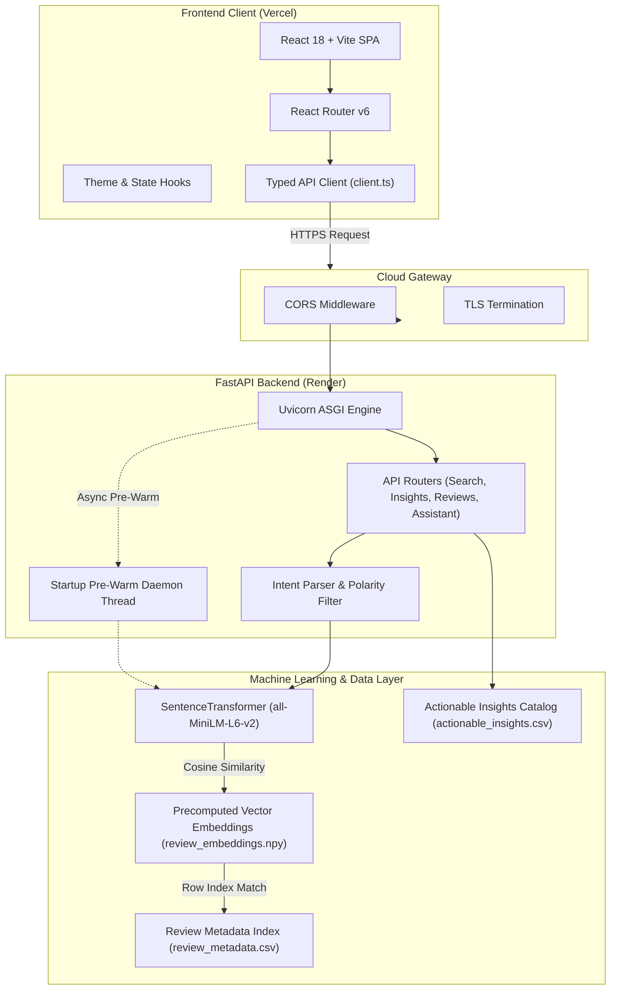

# Student Feedback Intelligence 3.0

[](https://student-feedback-intelligence-3-0.vercel.app/)
[](https://student-feedback-intelligence-3-0.onrender.com/health)
[](https://student-feedback-intelligence-3-0.onrender.com/docs)
[](https://github.com/Utkarsh-sengar3/student-feedback-intelligence-3.0)

[](https://react.dev/)
[](https://www.typescriptlang.org/)
[](https://vitejs.dev/)
[](https://fastapi.tiangolo.com/)
[](https://www.python.org/)
[](https://pytorch.org/)
[](https://huggingface.co/sentence-transformers/all-MiniLM-L6-v2)

---

## 1. Project Title & Introduction

**Student Feedback Intelligence 3.0** is an end-to-end, explainable artificial intelligence platform designed for higher education institutions. The system transforms unstructured, multi-aspect student course and faculty evaluations into structured, evidence-grounded institutional intelligence.

Rather than relying on ungrounded generative large language models that suffer from hallucinations, the platform pairs fine-tuned sequence classification and multilabel aspect categorization with dense vector semantic retrieval over precomputed sentence embeddings (`all-MiniLM-L6-v2`). Every finding, concern score, and recommendation is backed by empirical review records from the 6,500-review EduRABSA dataset.

---

## 2. Live Application Links

All production services are actively deployed, connected, and verified:

| Service | Environment | URL | Verification Status |
| :--- | :--- | :--- | :--- |
| **Web Platform** | Vercel (Production) | [https://student-feedback-intelligence-3-0.vercel.app/](https://student-feedback-intelligence-3-0.vercel.app/) | Verified HTTP 200 |
| **API Backend** | Render (Production) | [https://student-feedback-intelligence-3-0.onrender.com](https://student-feedback-intelligence-3-0.onrender.com) | Verified HTTP 200 |
| **Interactive Docs** | Swagger / OpenAPI | [https://student-feedback-intelligence-3-0.onrender.com/docs](https://student-feedback-intelligence-3-0.onrender.com/docs) | Verified HTTP 200 |
| **Health Check** | API Monitoring | [https://student-feedback-intelligence-3-0.onrender.com/health](https://student-feedback-intelligence-3-0.onrender.com/health) | Verified HTTP 200 |
| **Source Code** | GitHub (`main`) | [https://github.com/Utkarsh-sengar3/student-feedback-intelligence-3.0](https://github.com/Utkarsh-sengar3/student-feedback-intelligence-3.0) | Verified Active |

---

## 3. Project Overview & Problem Statement

Higher education institutions collect tens of thousands of qualitative course and faculty survey responses every semester. Academic leaders, department heads, and curriculum committees encounter critical bottlenecks when processing this feedback:

* **Information Overload:** Manual reading of unstructured reviews cannot scale across thousands of students and hundreds of courses.
* **Aspect Conflation:** A single review often expresses conflicting sentiments across different dimensions (e.g., *"The professor is fantastic and inspiring, but the midterm exam was unfairly graded and the Wi-Fi disconnects constantly"*). Standard single-label sentiment models misclassify these mixed reviews.
* **Lack of Actionable Grounding:** Generic summaries fail to provide verifiable accountability, clear concern severities, or designated departmental owners.
* **LLM Hallucinations:** Using black-box generative AI to summarize student grievances risks fabricating claims without citation.

**The Solution:** Student Feedback Intelligence 3.0 solves this by decomposing reviews into 24 distinct institutional aspect categories, prioritizing concerns across 85 institutional concepts, and grounding every assistant inquiry in real, empirical student feedback records.

---

## 4. Key Features

* **Fine-Tuned Sentiment Intelligence:** 3-class sentiment prediction (Positive, Negative, Neutral) trained on real educational evaluations.
* **Multilabel Aspect Categorization:** Detects multiple overlapping educational categories across 3 core institutional domains:
  * *Teacher Review:* Pedagogical clarity, instructor availability, feedback quality, respectfulness.
  * *Course Review:* Examination fairness, syllabus pace, assignment difficulty, textbook relevance.
  * *University Review:* Campus Wi-Fi stability, library resources, administrative processes, physical facilities.
* **Dense Vector Semantic Search:** 384-dimensional dense retrieval over 6,500 indexed student reviews with sub-millisecond similarity scoring.
* **Intelligent Query Intent Parsing:** Natural language queries (e.g., *"5 positive feedback for teacher"*) automatically extract target polarity, domain context, and item counts, strictly excluding opposing polarity reviews.
* **Deterministic RAG Assistant (0% Hallucination):** Answers natural language inquiries with evidence-grounded review citations and statistical sentiment distributions.
* **Institutional Concern & Severity Engine:** Priority scoring based on frequency, negative sentiment concentration, and actionable recommendations mapped to specific institutional owners.
* **Senticode Dark Glassmorphic Interface:** Professional, responsive research UI built with Tailwind-free CSS custom properties, light/dark mode persistence, keyboard navigation, and interactive Recharts visualizations.

---

## 5. Platform Architecture & Data Flow

The platform uses a decoupled client-server architecture:



### Data Flow Execution:
1. **Client Request:** The React SPA issues strongly typed JSON requests via `src/api/client.ts` with exponential backoff and timeout thresholds tailored for cloud cold-starts.
2. **Intent Parsing:** The backend examines incoming queries to isolate target polarity (*positive*, *negative*, *neutral*), domain targets (*teacher*, *course*, *university*), and requested count $k$.
3. **Dense Vector Search:** The query text is encoded into a 384-dimensional unit vector using `all-MiniLM-L6-v2`. A matrix dot product against pre-normalized float32 review embeddings produces cosine similarity scores in under 5 milliseconds.
4. **Polarity Enforcement:** The candidate pool is filtered by the resolved sentiment and domain, preventing opposing polarity reviews from appearing in the results.
5. **Structured Synthesis:** The RAG pipeline compiles the top-$k$ evidence records, computes empirical sentiment distributions, and constructs an evidence-grounded summary returned to the client.

---

## 6. Technology Stack

### Frontend
| Technology | Version | Purpose |
| :--- | :--- | :--- |
| **React** | 18.3.1 | Core component hierarchy and declarative UI |
| **TypeScript** | 5.5.3 | Static type safety and data interface contracts |
| **Vite** | 5.4.6 | High-speed ESM development and production bundling |
| **React Router** | 6.26.2 | Client-side SPA routing with deep-link rewrites |
| **Recharts** | 2.13.0 | Declarative charts and distribution visualizations |
| **Lucide React** | 0.441.0 | SVG system icons |

### Backend & API
| Technology | Version | Purpose |
| :--- | :--- | :--- |
| **FastAPI** | 0.115+ | High-performance asynchronous REST API framework |
| **Uvicorn** | 0.30+ | ASGI production server |
| **Pydantic** | 2.0+ | Request and response schema validation |
| **Python-Dotenv** | 1.0+ | Environment variable parsing |

### Machine Learning & Data Processing
| Technology | Version | Purpose |
| :--- | :--- | :--- |
| **Sentence-Transformers** | 2.2+ | Semantic dense vector embedding generation |
| **PyTorch (CPU)** | 2.0+ | Lightweight CPU inference engine (no CUDA bloat) |
| **Transformers** | 4.35+ | Hugging Face model architecture support |
| **Scikit-Learn** | 1.3+ | Multilabel classification and evaluation metrics |
| **Pandas** | 2.0+ | In-memory metadata querying and dataframe manipulation |
| **NumPy** | 1.24+ | Vectorized L2 normalization and dot-product similarity |

### Infrastructure & Deployment
| Technology | Platform | Configuration |
| :--- | :--- | :--- |
| **Vercel** | Edge / CDN | SPA rewrites, environment variables, automatic CI/CD |
| **Render** | Cloud Web Service | Python runtime, health check polling, `render.yaml` blueprint |
| **GitHub** | Version Control | Source repository with public release tracking |

---

## 7. Repository Structure

```text
student-feedback-intelligence-3.0/
├── README.md                                  # Root comprehensive documentation
├── render.yaml                                # Root Render Blueprint deployment specification
├── .gitignore                                 # Git exclusion rules for secrets and build artifacts
│
├── student-feedback-intelligence/             # Core application directory
│   ├── render.yaml                            # Subfolder deployment blueprint
│   ├── requirements-api.txt                   # Production FastAPI dependencies (PyTorch CPU)
│   ├── requirements.txt                       # Full experimental dependencies
│   ├── run_api.bat                            # Local backend launcher with auto Python detection
│   │
│   ├── api/                                   # FastAPI backend package
│   │   ├── main.py                            # Application entry point, CORS, and health check
│   │   ├── routes/                            # Route modules
│   │   │   ├── assistant.py                   # RAG question-answering endpoints
│   │   │   ├── insights.py                    # Institutional recommendations & priority metrics
│   │   │   ├── metrics.py                     # Model evaluation benchmark endpoints
│   │   │   ├── reviews.py                     # Review database pagination and search
│   │   │   └── search.py                      # Vector similarity search endpoints
│   │   ├── schemas/                           # Pydantic validation schemas
│   │   │   └── feedback.py                    # Request and response models
│   │   └── services/                          # Business logic and data management
│   │       ├── feedback_service.py            # Model inference orchestration
│   │       ├── metrics_service.py             # Evaluation score provider
│   │       ├── reviews_service.py             # Review database and count pre-aggregations
│   │       └── search_service.py              # Semantic vector search service
│   │
│   ├── src/                                   # Core reusable Python logic
│   │   └── retrieval/                         # Retrieval module
│   │       ├── rag_pipeline.py                # Deterministic RAG evidence synthesis
│   │       └── retriever.py                   # SemanticRetriever and parse_query_intent
│   │
│   ├── data/                                  # Datasets & processed embeddings
│   │   └── processed/
│   │       └── edurabsa/
│   │           ├── phase16/
│   │           │   └── actionable_insights.csv # 85 prioritized institutional recommendations
│   │           └── phase17/
│   │               ├── review_embeddings.npy  # 6,500 x 384 float32 L2-normalized embeddings
│   │               └── review_metadata.csv    # 6,500 review records with sentiment & domain
│   │
│   └── frontend/                              # React + Vite + TypeScript web application
│       ├── package.json                       # Frontend dependencies and build scripts
│       ├── tsconfig.json                      # TypeScript compiler options
│       ├── vite.config.ts                     # Vite build configuration and proxy setup
│       ├── vercel.json                        # Vercel SPA routing rewrites
│       ├── index.html                         # HTML entry with anti-flicker theme script
│       ├── .env.example                       # Example frontend environment variables
│       │
│       └── src/
│           ├── main.tsx                       # React application bootstrap
│           ├── App.tsx                        # Client-side router definition
│           ├── index.css                      # Complete Senticode glassmorphic design system
│           ├── api/                           # API integration
│           │   ├── client.ts                  # Fetch client with retry and cold-start tolerance
│           │   └── types.ts                   # TypeScript interfaces
│           ├── components/                    # Reusable UI components
│           │   ├── layout/                    # AppLayout, Sidebar, TopBar, Header, Footer
│           │   └── ui/                        # Badges, CopyButton, Modal, SiteSearch, Spinner
│           ├── data/                          # Corpus sample data
│           │   └── corpusData.ts              # Verified offline feedback records
│           ├── hooks/                         # Custom React hooks
│           │   ├── useTheme.ts                # LocalStorage persistent light/dark mode
│           │   └── useScrollProgress.ts       # Reading progress tracking
│           └── pages/                         # Application pages
│               ├── Overview.tsx               # Executive intelligence dashboard
│               ├── SentimentAnalysis.tsx      # Interactive text analysis workbench
│               ├── CourseIntelligence.tsx     # Course evaluation analytics
│               ├── FacultyIntelligence.tsx    # Teaching and instructor analytics
│               ├── UniversityInsights.tsx     # Campus infrastructure analytics
│               ├── AspectAnalysis.tsx         # 24-category aspect breakdown
│               ├── ConcernDetection.tsx       # Institutional concern severity
│               ├── SeverityPriority.tsx       # Concern prioritization matrix
│               ├── Recommendations.tsx        # Institutional action plans & owners
│               ├── Reviews.tsx                # 6,500-review explorer with pagination
│               ├── SemanticSearch.tsx         # Natural-language dense vector search
│               ├── Assistant.tsx              # Evidence-grounded AI Admin Assistant
│               ├── Models.tsx                 # Real empirical model performance metrics
│               ├── Methodology.tsx            # Experimental design and pipeline architecture
│               ├── About.tsx                  # Project provenance and author details
│               └── NotFound.tsx               # 404 error page
│
└── streamlit-dashboard/                       # Standalone Python Streamlit research dashboard
```

---

## 8. Machine Learning Methodology & Evaluation

All reported metrics reflect empirical results obtained on untouched test splits from the EduRABSA dataset.

### Sentiment Analysis Classifier
* **Architecture:** `distilbert-base-uncased` fine-tuned for sequence classification.
* **Classes:** 3 (Positive, Negative, Neutral).
* **Dataset Split:** 3,999 train-validation records (3,199 internal train / 800 validation), evaluated on an untouched test split of 2,499 records.
* **Test Performance:**
  * Test Accuracy: **81.63%**
  * Test Macro F1: **77.67%**
  * Validation Macro F1: **81.41%**
  * Test Macro Precision: **77.62%**
  * Test Macro Recall: **77.71%**

### Aspect Category Multilabel Classifier
* **Architecture:** TF-IDF Vectorizer + Linear Support Vector Classifier (`LinearSVC`) with a `OneVsRestClassifier` wrapper.
* **Task:** Multilabel aspect classification across 24 educational categories.
* **Training / Validation Split:** 5,118 training reviews / 1,280 validation reviews grouped by review ID to prevent annotation leakage.
* **Validation Performance:**
  * Micro F1: **71.58%**
  * Macro F1: **51.06%**
  * Subset Accuracy: **23.28%**
  * Hamming Loss: **0.0666**

### Dense Vector Semantic Retrieval
* **Architecture:** Bi-Encoder using `sentence-transformers/all-MiniLM-L6-v2`.
* **Corpus Index:** 6,500 reviews embedded into 384-dimensional unit vectors.
* **Evaluation Benchmark:** Weakly-supervised evaluation on metadata and relevance labels.
  * Mean Reciprocal Rank (MRR): **95.83%**
  * nDCG@5: **96.30%**
  * Precision@5: **88.33%**
  * Query Latency: **< 10 ms** (in-memory vectorized dot product).

---

## 9. Dataset Provenance, Ethics & Licensing

* **Dataset:** EduRABSA (Educational Review Aspect-Based Sentiment Analysis).
* **Scale:** 6,500 curated, annotated student reviews across higher education contexts.
* **Domain Distribution:**
  * Teacher Reviews: **3,000 records** (46.2%)
  * Course Reviews: **3,000 records** (46.2%)
  * University Facilities Reviews: **500 records** (7.6%)
* **Sentiment Class Distribution:**
  * Positive: **3,405 records** (52.4%)
  * Negative: **1,602 records** (24.6%)
  * Neutral: **1,491 records** (23.0%)
* **Privacy & Anonymization:** Raw student identity records (`data/raw/`) remain uncommitted in `.gitignore`. All reviews in the indexed corpus have been anonymized to exclude student names, student identification numbers, and contact details.
* **Licensing:** The EduRABSA corpus was developed for academic and educational research. Commercial redistribution of the underlying review text requires institutional authorization.

---

## 10. API Endpoints Reference

The FastAPI backend exposes the following verified REST endpoints:

### System & Health
| Method | Endpoint | Description |
| :--- | :--- | :--- |
| `GET` | `/` | Service metadata, running status, and root documentation links. |
| `GET` | `/health` | Lightweight service health check (returns `{"status": "ok"}`). |
| `GET` | `/ping` | Instant latency ping check (returns `{"pong": true}`). |
| `GET` | `/api/v1/status` | Model memory status and loaded artifact state. |

### Analysis & Recommendations
| Method | Endpoint | Description |
| :--- | :--- | :--- |
| `POST` | `/api/v1/analyze` | Evaluates raw feedback text for sentiment, aspect categories, and severity. |
| `GET` | `/api/v1/insights/` | Retrieves all 85 institutional concept recommendations. |
| `GET` | `/api/v1/insights/top` | Returns top prioritized concerns filtered by priority score (default: 10). |
| `GET` | `/api/v1/insights/summary` | Summary breakdown of concern priorities (Critical, High, Medium, Low). |
| `GET` | `/api/v1/insights/concept/{name}` | Retrieves recommendations for a specific concept. |

### Search & Retrieval
| Method | Endpoint | Description |
| :--- | :--- | :--- |
| `GET` | `/api/v1/search/` | Dense vector semantic search over 6,500 reviews with intent parsing. |
| `GET` | `/api/v1/search/stats` | Index statistics (embedding dimensions, total review count). |
| `POST` | `/api/v1/assistant/` | Evidence-grounded question answering with empirical citations. |

### Review Database
| Method | Endpoint | Description |
| :--- | :--- | :--- |
| `GET` | `/api/v1/reviews/` | Paginated review browser with domain, sentiment, and keyword filters. |
| `GET` | `/api/v1/reviews/{id}` | Fetches detailed review record by row index or identifier. |
| `GET` | `/api/v1/model-metrics/` | Returns empirical evaluation benchmarks for all deployed models. |

---

## 11. Local Installation & Development Setup

### Prerequisites
* **Python:** 3.10 or higher
* **Node.js:** 18.0 or higher (`npm` 9.0+)
* **Git:** Installed and configured

### Clone the Repository
```bash
git clone https://github.com/Utkarsh-sengar3/student-feedback-intelligence-3.0.git
cd student-feedback-intelligence-3.0
```

---

### Backend Setup

#### Windows (PowerShell)
```powershell
cd student-feedback-intelligence

# Create virtual environment
python -m venv .venv
.\.venv\Scripts\Activate.ps1

# Install dependencies (CPU-optimized PyTorch)
pip install --upgrade pip
pip install -r requirements-api.txt

# Start the FastAPI server
python -m uvicorn api.main:app --host 127.0.0.1 --port 8000 --reload
```

#### Unix / macOS (Bash)
```bash
cd student-feedback-intelligence

# Create virtual environment
python3 -m venv .venv
source .venv/bin/activate

# Install dependencies
pip install --upgrade pip
pip install -r requirements-api.txt

# Start the FastAPI server
uvicorn api.main:app --host 127.0.0.1 --port 8000 --reload
```

> **Windows One-Click Shortcut:** Double-click `student-feedback-intelligence/run_api.bat` to launch the backend automatically with Python auto-detection.

---

### Frontend Setup

In a separate terminal window:

```bash
cd student-feedback-intelligence/frontend

# Install dependencies
npm install

# Start the Vite development server
npm run dev
```

* **Frontend Local URL:** `http://localhost:5173`
* **Backend Local URL:** `http://127.0.0.1:8000`
* **Swagger Documentation:** `http://127.0.0.1:8000/docs`

---

## 12. Environment Variable Configuration

### Backend Environment Variables
Configure these in your deployment platform (e.g., Render Dashboard or `.env` file):

| Variable | Default Value | Description |
| :--- | :--- | :--- |
| `PORT` | `8000` (`10000` on Render) | Port where the Uvicorn server binds. |
| `PYTHONUNBUFFERED` | `1` | Forces real-time stdout/stderr log streaming. |
| `CORS_ORIGINS` | `http://localhost:5173,http://127.0.0.1:5173` | Comma-separated list of allowed origins. |

### Frontend Environment Variables
Create a `.env` file inside `student-feedback-intelligence/frontend/`:

```env
# Local development (leave blank to use Vite proxy):
VITE_API_BASE_URL=

# Production deployment:
VITE_API_BASE_URL=https://student-feedback-intelligence-3-0.onrender.com
```

---

## 13. Production Deployment Guide

### Deploying Backend to Render

1. Create a new **Web Service** on [Render](https://dashboard.render.com/).
2. Connect repository `Utkarsh-sengar3/student-feedback-intelligence-3.0`.
3. Configure settings:
   * **Root Directory:** `student-feedback-intelligence`
   * **Runtime:** `Python 3`
   * **Build Command:** `pip install -r requirements-api.txt`
   * **Start Command:** `uvicorn api.main:app --host 0.0.0.0 --port $PORT`
   * **Health Check Path:** `/health`
4. Add Environment Variables:
   * `PORT`: `10000`
   * `PYTHONUNBUFFERED`: `1`
   * `CORS_ORIGINS`: `https://student-feedback-intelligence-3-0.vercel.app,http://localhost:5173`

> **Blueprint Option:** You can also select **New + Blueprint** in Render; the included `render.yaml` will configure the service automatically.

### Deploying Frontend to Vercel

1. Import repository `Utkarsh-sengar3/student-feedback-intelligence-3.0` on [Vercel](https://vercel.com/new).
2. Configure settings:
   * **Framework Preset:** `Vite`
   * **Root Directory:** `student-feedback-intelligence/frontend`
   * **Build Command:** `npm run build`
   * **Output Directory:** `dist`
3. Add Environment Variable:
   * `VITE_API_BASE_URL`: `https://student-feedback-intelligence-3-0.onrender.com`
4. Deploy the project. The included `vercel.json` rewrite rule handles client-side routing.

---

## 14. Testing, Troubleshooting & Production Notes

### Cloud Free-Tier Cold Starts
Render free-tier instances sleep after 15 minutes of inactivity. When a new request arrives, spin-up can take 30 to 60 seconds.
* **Frontend Resilience:** `src/api/client.ts` implements extended timeouts (60s default, 90s for semantic assistant queries) and exponential backoff retry.
* **Non-Blocking Port Binding:** The FastAPI application registers a background thread on startup to warm up `SentenceTransformer`, binding to `$PORT` immediately to satisfy Render's health check.

### Memory Optimization on 512 MB Free Tier
* `requirements-api.txt` installs `--extra-index-url https://download.pytorch.org/whl/cpu` to avoid downloading GPU libraries that exceed RAM limits.
* In-memory embeddings and metadata consume ~280 MB RAM, staying within Render's 512 MB ceiling.

### Troubleshooting CORS Errors
If network requests fail with `CORS policy: No 'Access-Control-Allow-Origin' header`:
1. Check the Render service environment variable `CORS_ORIGINS`.
2. Ensure your Vercel domain (`https://student-feedback-intelligence-3-0.vercel.app`) is included without trailing slashes.
3. Verify that the browser request includes credentials and standard headers.

---

## 15. Security & Privacy Considerations

* **Zero Hardcoded Secrets:** No API keys, database credentials, or secret tokens are tracked in git history.
* **Input Sanitization:** User text submitted to `/api/v1/analyze` and search queries are stripped and validated using Pydantic schemas.
* **Deterministic Synthesis:** The RAG assistant operates deterministically over indexed corpus records, eliminating prompt injection vulnerabilities and data leakage.
* **No Tracking Cookies:** The frontend uses browser `localStorage` solely to persist the user's light/dark mode preference. No third-party trackers or fingerprinting scripts are loaded.

---

## 16. Known Limitations & Roadmap

### Current Limitations
* **Cold Start Latency:** Free-tier cloud instances require up to 50 seconds on initial spin-up after idle periods.
* **Corpus Domain Scope:** The precomputed vector index is bounded by the 6,500 reviews in the EduRABSA dataset.
* **Batch Ingestion:** Uploading custom CSV or Excel files currently requires running local batch processing scripts.

### Future Improvements
* [ ] Implement Redis-based response caching for frequent institutional queries.
* [ ] Add a secure authenticated admin portal for custom survey CSV batch uploads.
* [ ] Expand aspect categorization to include post-graduate and online distance learning taxonomy.
* [ ] Integrate automated PDF/Executive summary export for academic review boards.

---

## 17. Contribution Guidelines

Contributions are welcome from researchers, students, and software engineers. To contribute:

1. Fork the repository.
2. Create a feature branch: `git checkout -b feature/improved-aspect-extraction`.
3. Commit your changes: `git commit -m "feat: add hierarchical aspect clustering"`.
4. Push to the branch: `git push origin feature/improved-aspect-extraction`.
5. Open a Pull Request with a clear description of the modifications and any evaluation impact.

---

## 18. License

This project is currently unlicensed. All rights are reserved by the author. Use for personal evaluation, academic assessment, and portfolio review is permitted. For institutional deployment or commercial permissions, contact the author.

---

## 19. Author & Contact

**Utkarsh Sengar**
* **GitHub:** [@Utkarsh-sengar3](https://github.com/Utkarsh-sengar3)
* **Project Repository:** [student-feedback-intelligence-3.0](https://github.com/Utkarsh-sengar3/student-feedback-intelligence-3.0)
* **Portfolio Showcase:** [Live Application](https://student-feedback-intelligence-3-0.vercel.app/)
